# Monemee SDK: sell your app with license keys, a paywall and checkout

[](https://www.npmjs.com/package/monemee)
[](https://www.npmjs.com/package/monemee-node)
[](https://pypi.org/project/monemee/)
[](https://github.com/monemee/monemee-sdk/actions/workflows/test.yml)
[](LICENSE)

**English** · [Deutsch](README.de.md) · [Documentation](https://dev.monemee.com) · [API reference](openapi.yaml)

The Monemee SDK turns an app you built into a product people can buy. It adds a hosted checkout, unlocks the buyer inside your app right after payment, and validates license keys for desktop and downloadable software, offline included. One command sets it up: `npx monemee init`.

It is built for developers who would rather ship features than build billing: indie hackers, agencies, and anyone selling an app they made with Cursor, Claude Code, Lovable or by hand.

```bash
npx monemee init
```



The CLI logs you in through the browser, creates the product, writes your `.env` and wires Monemee into your code. Everything starts in test mode, so you can try the purchase flow without real money: a test purchase skips the payment step, and everything from the return to your app on is real.

## Contents

- [What you get](#what-you-get)
- [Add a paywall to a web app](#add-a-paywall-to-a-web-app-express-nextjs-react)
- [License key validation for desktop apps](#license-key-validation-for-desktop-and-downloadable-software)
- [Ship new versions from GitHub Releases](#ship-new-versions-from-github-releases)
- [Guides](#guides)
- [Packages](#packages)
- [How the purchase flow works](#how-the-purchase-flow-works)
- [Security](#security)
- [FAQ](#faq)

## What you get

| Feature | What it means for you |
|---|---|
| Hosted checkout | A buy link per product. Card payments run through Stripe; you never touch card data. |
| Unlock after purchase | Buyers return to your app and are already unlocked. No key to copy, no extra database column. |
| Access checks | `requireAccess()` on the server, `<AccessGate>` in React. Refunds revoke access automatically. |
| License keys | Device activation limits, expiry dates and plan names for downloadable software. |
| Offline licensing | Every license response is signed with Ed25519, so apps keep working without a connection for a grace period. |
| Test mode | Separate test and live secrets. Test purchases cost nothing: they skip the payment step, and from the return on they behave exactly like real ones. |
| Release automation | A GitHub Action uploads each release; existing buyers get the new version through their links. |
| AI assistant support | [`AGENTS.md`](AGENTS.md) and ready-made skills let Claude Code, Cursor or Copilot do the setup. |

## Add a paywall to a web app (Express, Next.js, React)

For apps where buyers log in, Monemee binds each purchase to the user ID of your own login. Your server asks Monemee whether that user has access.

```js
// server.js (Express)
const monemee = require('monemee-node')({ getRef: (req) => req.user?.id });

app.use(monemee.webhook());        // before express.json()
app.use(express.json());
app.use(session(/* your login */));
app.use(monemee.routes());         // after your login

app.get('/api/pro', monemee.requireAccess(), (req, res) => {
  res.json({ plan: req.monemee.plan });
});
```

```jsx
// App.jsx (React)
import { MonemeeProvider, AccessGate, BuyButton } from 'monemee-react';

<MonemeeProvider>
  <AccessGate fallback={<BuyButton>Unlock Pro</BuyButton>}>
    <ProFeature />
  </AccessGate>
</MonemeeProvider>
```

Next.js uses one route file: `export const { GET, POST } = monemee.nextRoute();`. Apps that authenticate with a browser token (Firebase, Supabase, Auth0) pass it through `getHeaders`. Details are in the [monemee-node](packages/node) and [monemee-react](packages/react) docs. A complete runnable app lives in [templates/express-react](templates/express-react).

## License key validation for desktop and downloadable software

Buyers receive a license key by email. Your app activates it once per device and checks it on every start.

```js
// Electron, Tauri, browser extensions, Node CLIs
import { createLicense } from 'monemee-client';

const license = createLicense({ productId: 123 });
await license.activate('MM-XXXX-XXXX-XXXX-XXXX');

const { valid, plan, offline } = await license.check();
if (valid) startPro(plan);
```

```python
# Python tools and desktop apps: pip install "monemee[offline]"
from monemee import License

license = License(product_id=123)
if license.check().valid:
    run_pro()
```

`check()` verifies the signature of every response and keeps the last valid one. Without a network connection the license stays valid for `graceDays` (default: 7). See [monemee-client](packages/client) and the [Python package](packages/python).

## Ship new versions from GitHub Releases

```yaml
# .github/workflows/monemee.yml
on:
  release:
    types: [published]
jobs:
  upload:
    runs-on: ubuntu-latest
    steps:
      - uses: actions/checkout@v4
      - run: npm ci && npm run build && zip -r app.zip dist
      - uses: monemee/monemee-sdk/action@v1
        with:
          api-key: ${{ secrets.MONEMEE_API_KEY }}
          product-id: 123
          file: app.zip
```

The file is replaced inside the existing product, so download links already sent to buyers keep working and deliver the new version. More in the [action docs](action).

### Buy button for your README

```markdown
[](https://monemee.com/p/123)
```

## Guides

Step-by-step guides on [dev.monemee.com](https://dev.monemee.com/guides/):

- [Add license key validation to an Electron app](https://dev.monemee.com/guides/electron-license-key/)
- [Sell a Chrome extension with license keys (Manifest V3)](https://dev.monemee.com/guides/chrome-extension-license-key/)
- [Add a paywall to a Next.js App Router app](https://dev.monemee.com/guides/nextjs-paywall/)
- [Add a paywall to an Express and React app](https://dev.monemee.com/guides/express-react-paywall/)
- [License key validation for a Python CLI or desktop app](https://dev.monemee.com/guides/python-license-key/)
- [Add license key validation to a Tauri app](https://dev.monemee.com/guides/tauri-license-key/)
- [Test the purchase flow without paying](https://dev.monemee.com/guides/test-purchase-flow/)

## Packages

| Package | Install | Use it for |
|---|---|---|
| [`monemee`](packages/cli) (CLI) | `npx monemee init` | Setup, test purchases, going live, diagnostics |
| [`monemee-node`](packages/node) | `npm i monemee-node` | Server side of web apps: Express, Next.js, Hono and other Web-standard runtimes |
| [`monemee-react`](packages/react) | `npm i monemee-react` | Paywall components and the `useAccess` hook |
| [`monemee-client`](packages/client) | `npm i monemee-client` | License keys in Electron, Tauri, extensions and CLIs |
| [`monemee`](packages/python) (Python) | `pip install monemee` | License keys and web access in Python, Flask, FastAPI, Django |
| [GitHub Action](action) | `uses: monemee/monemee-sdk/action@v1` | Upload release files as new product versions |

Examples for Electron, Chrome extensions, Flask, Next.js and Python CLIs are in [examples](examples).

## How the purchase flow works

1. Your app links to `/monemee/buy`. The SDK redirects to the checkout with the current user attached.
2. The buyer pays. Monemee issues a license and redirects back to your app with a one-time token.
3. Your server redeems the token with its app secret. The license is now bound to that user.
4. From then on, `hasAccess(userId)` answers with `true`. Refunds and revocations switch it to `false`, instantly if you use webhooks.

Downloadable software skips steps 1 and 3: the buyer enters the key from the purchase email, and the app activates it.

## Security

- The app secret (`mmapp_…`) stays on your server and can only check and unlock access for one product.
- Return tokens are single-use and expire after 30 minutes.
- A redeemed license belongs to exactly one user, so forwarding a link or key does not unlock a second account.
- Webhooks are signed with HMAC-SHA256 and rejected after five minutes.
- License responses are signed with Ed25519; the public key ships with the packages and is published at `/.well-known/monemee-license-keys.json`.

Report vulnerabilities as described in [SECURITY.md](SECURITY.md).

## FAQ

### How do I add license key validation to my app?
Install `monemee-client` (JavaScript) or `monemee` (Python), call `activate(key)` once and `check()` on every start. Monemee handles key generation, delivery by email, device limits, expiry and refunds.

### Does license validation work offline?
Yes. Every response is signed with Ed25519. The SDK stores the last valid response and accepts it without a connection for a configurable grace period, seven days by default. Tampered or foreign responses are rejected.

### Do I need my own database to track who paid?
No. Purchases are bound to the user ID of your login. Your server asks `hasAccess(userId)` and caches the answer for five minutes.

### How do I test the purchase flow without paying?
`npx monemee init` creates a test secret. Run `npx monemee test-buy` or click the test purchase button in the paywall. Test licenses behave like real ones and are only visible in test mode.

### Which frameworks are supported?
Express and Next.js (App Router) on the server, plus any runtime with Web-standard `Request`/`Response` such as Hono, Bun or Deno; React in the browser; Electron, Tauri, browser extensions and Node CLIs for downloadable software; Python with Flask, FastAPI and Django.

### What does it cost?
The SDK is free and MIT licensed. Monemee takes a fee per sale that drops from 29% to 9% as your revenue grows. There is no monthly fee. See [monemee.com](https://monemee.com).

### Can my AI coding assistant set this up?
Yes. Tell it "sell this app with Monemee". It reads [AGENTS.md](AGENTS.md). Claude Code and Cursor skills are in [skills](skills).

## Contributing

Bug reports and pull requests for the SDK are welcome; read [CONTRIBUTING.md](CONTRIBUTING.md) first. For questions about your Monemee account, use the support form in the dashboard.

## License

[MIT](LICENSE)
